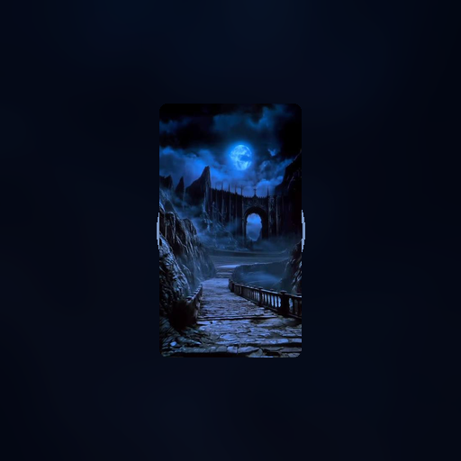

# Dark Fantasy


<p align="center">
  
</p>

**A six-zone dreamcore parkour game through surreal, liminal worlds.**

Explore abandoned halls, poolrooms, overgrown passages, and a seemingly
endless tower. This repository contains the original Python/Ursina desktop
game and its separate Godot port for Windows and Android.

> **[Download the latest release](https://github.com/ayushbroo276/darkfantasygame/releases/latest)**
> — includes the current Android APK and Windows game package.

## Features

- Six atmospheric zones with checkpoints, moving platforms, and timed challenges.
- First-person movement, jumping, sprinting, and wall-running.
- Chapter progression, local saves, settings, and completion screens.
- Windows keyboard/mouse controls and Android touchscreen controls.
- Six soundtrack selections in the Godot version, with optional custom audio import.

## Choose a version

### Godot — Windows and Android

Open [`godot_project/`](./godot_project/) in Godot 4.7.2 and run the main scene.
For a prebuilt game, visit the [latest release](https://github.com/ayushbroo276/darkfantasygame/releases/latest).

The Android APK supports ARM64 and ARMv7 devices running Android 7.0 (API 24)
or later. It is debug-signed, not signed with a production Play Store key.
See the [Godot guide](./godot_project/README.md) for export details and known
limitations.

### Original Ursina — Windows

Python 3.10 or later is required. From the repository root:

```powershell
python -m pip install -r requirements.txt
python main.py
```

Gameplay starts fullscreen. Press **F11** to toggle fullscreen.

| Action | Windows control |
| --- | --- |
| Move | WASD |
| Look | Mouse |
| Jump | Space |
| Sprint | Left Shift |
| Wall-run | E |
| Pause | Esc |

The legacy `main.py` and `game_zones.py` launch/import shims remain at the
repository root. The organized Ursina implementation is in `src/dark_fantasy/`.

## Project layout

```text
assets/
  audio/
    ambient/          # Zone ambience and gameplay sound effects
    music/            # Optional local Ursina soundtrack files (not committed)
  zone1_.../          # Chapter textures
  ...
src/dark_fantasy/     # Ursina package
tests/                # Python asset-integrity tests
tools/                # Source texture generators
godot_project/        # Godot project, Android plugin, and export settings
.github/workflows/    # Automated Python checks
```

Ursina soundtracks are not included in the repository. To use tracks that you
have permission to use, place their MP3 files in `assets/audio/music/` with
these filenames: `resonance.mp3`, `weeks.mp3`, `comfort.mp3`, `school.mp3`,
`numbers.mp3`, and `undertale.mp3`. This local folder is ignored by Git.

The source image generators require Pillow. Install that optional dependency
with `python -m pip install -e ".[asset-tools]"`, then run scripts from `tools/`.

## Tests

Run the Python syntax and asset checks:

```powershell
python -m compileall -q main.py game_zones.py src tools tests
python -m unittest discover -s tests -v
```

Run the Godot gameplay smoke test with Godot 4.7.2:

```powershell
& 'C:\path\to\Godot_v4.7.2-stable_win64_console.exe' --headless --path .\godot_project --script res://tests/smoke_test.gd --audio-driver Dummy
```

## Asset permissions

Only redistribute artwork, sound, or music when you have permission to do so.
Godot's included soundtrack and launcher artwork are documented in
[`godot_project/README.md`](./godot_project/README.md).
